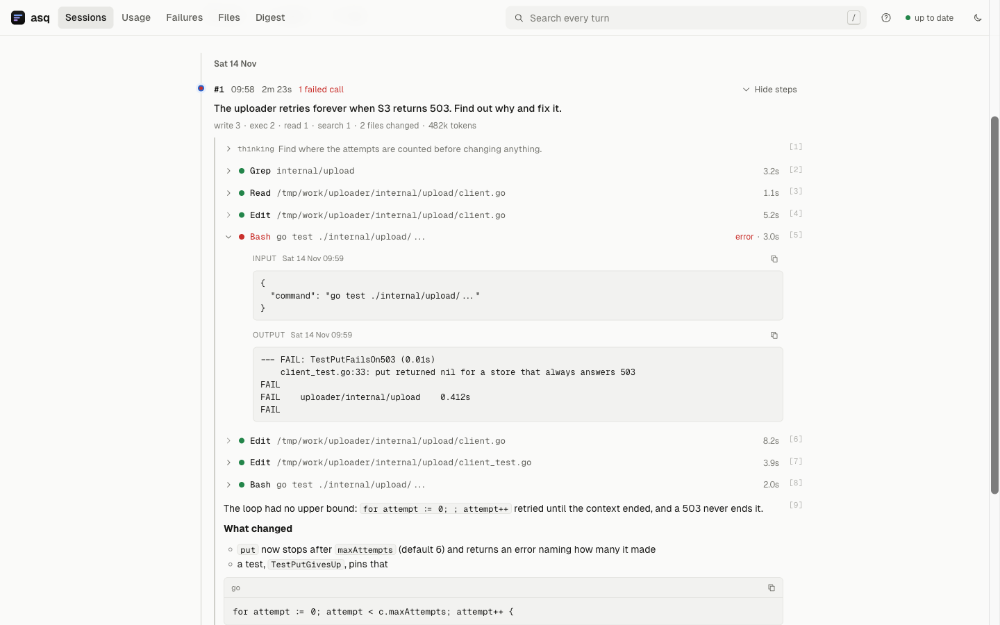

# asq

**The session history of every agent CLI on your machine, as one record you can search, read, hand over and measure.**

[中文说明](README.zh-CN.md)

Claude Code, Codex, Gemini CLI, OpenCode, Grok, Antigravity, Pi, DeepSeek Harness, Hermes,
OpenClaw and GitHub Copilot CLI each keep a transcript of what they did — in eleven different
shapes, in eleven different places. `asq` reads them all into one model and answers the
questions you actually have:

- *How did I fix this last time?* — full-text search over every turn of every session
- *What was that agent doing?* — read any session as a list of turns, then step by step
- *Pick this up from where it stopped* — a handoff brief another agent can start from
- *Where did the tokens go?* — input, output, reasoning and cache hit rate, by model, day, project and session
- *How long did agents work, and when?* — agent time by day, week and month, and the hours of the week it fell in
- *What keeps failing?* — every failed tool call, with the command and the end of its output, whether
  the same command passed later, and by command, what is still open

It is one static binary. It only ever reads. Nothing leaves your machine unless you tell it to.

```console
$ asq ls
claude/aaaa1111  idle · 28m ago · 2 turns · 1 failed · 1 agent · /work/alpha · main
  Fix flaky test
codex/bbbb2222   2d ago · 1 turn · /work/beta · release
  rotate the deploy key

$ asq search ECONNREFUSED
1 turn in 1 session

1. claude/aaaa1111-0000-4000-8000-000000000001#1  2026-11-13 17:43 · /work/alpha  ✗1 failed
   ask    fix the flaky test
   output Bash › --- FAIL: TestOrder dial tcp: ECONNREFUSED 127.0.0.1:5432 exit status 1
   answer The test depended on map order; fixed by sorting the keys.

$ asq show claude/aaaa1111#1
claude/aaaa1111-0000-4000-8000-000000000001#1 · 2026-11-13 17:43 · 20s · exec 1 · failed 1 · 2.1k in · 70 out · cache 92%

17:43:39 ASK
    fix the flaky test
17:43:44 thinking the order of a map is not stable
17:43:44 Bash go test ./...  ✗ failed · 2s  [2]
    --- FAIL: TestOrder
    dial tcp: ECONNREFUSED 127.0.0.1:5432
    exit status 1

17:43:59 REPLY
    The test depended on map order; fixed by sorting the keys.
```

## The idea

Whatever the CLI, a session is the same thing: **a person asked, an agent worked, the agent
answered.** That exchange is the unit here — a *turn* — and everything `asq` offers is a view of
turns:

```
Session ─┬─ Turn 1   the ask → replies, reasoning, tool calls with their results → the answer
         ├─ Turn 2
         │    └─ a subagent the turn started: a session of its own, beneath this one
         └─ Turn n
```

An adapter per CLI converts its transcript into this record and does nothing else. Listing,
search, briefs, usage, failures, traces and the web page are written once, over the record, so
they work the same for every CLI — and a new CLI is one small package. Token counts are
normalized on the way in (input never includes cached tokens; output always includes reasoning),
so a sum across CLIs adds like with like. → [The record](docs/model.md)

## Install

**macOS and Linux** — downloads the release for your machine, verifies it against the
published checksums, and installs it to `~/.local/bin` — the user's own directory, no
sudo (what `asq` reads is that user's sessions). If the directory is not on your PATH
the script prints the line to add; to install machine-wide instead,
`INSTALL_DIR=/usr/local/bin sh install.sh` — that one asks for sudo:

```sh
curl -fsSL https://raw.githubusercontent.com/itswl/agent-session-query/main/install.sh | sh
```

**Windows** (PowerShell):

```powershell
irm https://raw.githubusercontent.com/itswl/agent-session-query/main/install.ps1 | iex
```

**Homebrew** (macOS and Linux) and **Scoop** (Windows), with this repository as the tap and the
bucket — `brew upgrade` and `scoop update asq` then follow the releases:

```sh
brew tap itswl/asq https://github.com/itswl/agent-session-query
brew install itswl/asq/asq
```

```powershell
scoop bucket add asq https://github.com/itswl/agent-session-query
scoop install asq/asq
```

**With Go** (1.26 or newer; no cgo, no other toolchain):

```sh
go install github.com/itswl/agent-session-query/cmd/asq@latest
```

Or take an archive from the [releases](https://github.com/itswl/agent-session-query/releases)
(amd64 and arm64 for all three systems), or run the container image
`ghcr.io/itswl/agent-session-query` — see [Deploying](docs/deploy.md).

Then:

```sh
asq doctor     # which stores were found, and whether each reads
asq ls         # the first run indexes your history: about a minute per gigabyte
```

The checksums the installers check come from the same release as the archives: they catch a
download gone wrong, not a release replaced. What says where a file came from is its build
attestation — every archive, installer and image has one, signed by the release workflow, naming
the run and the commit that built it:

```sh
gh attestation verify asq-darwin-arm64.tar.gz --repo itswl/agent-session-query
gh attestation verify oci://ghcr.io/itswl/agent-session-query:latest --repo itswl/agent-session-query
```

## Upgrading

Run the installer again. It puts the new release where the `asq` on your PATH already is, over
it — with sudo, if that directory takes it: what runs is then the new one, and macOS keeps what
it allowed the old. One Homebrew or Scoop installed it leaves to them: `brew upgrade asq`,
`scoop update asq`. With Go it is the same `go install …@latest`; a container is pulled and
started again ([Deploying](docs/deploy.md#upgrading)).

An `asq serve` kept running goes on with the old one until it is restarted. The page says so,
and so does `asq doctor`, which asks a server on this machine which `asq` it runs. Run
`asq service install` again to restart the one it set up, or:

```sh
launchctl kickstart -k "gui/$(id -u)/io.github.itswl.asq"     # macOS, the LaunchAgent
systemctl --user restart asq                                    # Linux, the systemd unit
brew services restart asq                                       # Homebrew's own service
```

On Windows a running `asq.exe` cannot be replaced: `schtasks /end /tn asq`, then the installer
or `scoop update asq`, then `schtasks /run /tn asq`. The index needs nothing: a release that
reads a CLI's files differently reads them again by itself, at its first look at the stores.

## Uninstall

`asq uninstall` removes what asq wrote: the index, and the state — the sign-in key, what a
collector was sent, what `asq keep` was asked to keep. The rest it says as commands, in the
order to run them:

1. what keeps `asq serve` running, taken down: `asq service uninstall` for the service it set
   up, while the binary is there to run it; `brew services stop asq` for Homebrew's; for one
   set up by hand — a LaunchAgent or a user unit that runs `asq serve`, or the task named
   `asq` — its manager's commands;
2. `asq uninstall` again, when there was a service, for the index it wrote until it stopped;
3. the binary: `brew uninstall asq`, and `brew untap` when the tap is this repository, or
   `scoop uninstall asq`, for one they installed; otherwise `rm` where it is (`sudo`, when its
   directory needs it), or on Windows `Remove-Item` of its folder when that holds nothing else.

`asq uninstall --json` answers the same: `removed`, `left`, `run`. What it leaves:

- The copies `asq keep` made, if it was asked to: the only record of what a CLI has deleted
  since. They stay where they are — `kept` in the state directory, or the folder
  `asq keep --dir` named — and uninstall says where, how many transcripts they hold and how many
  of those the CLI has deleted, and the command that removes them.
- The CLIs' stores, which are your history, and are never touched.
- What else is in a folder `ASQ_STATE` names, or one the state directory is a link to: only
  the files asq writes there go, and the folder itself once that leaves it empty.
- The `asq` MCP server each agent CLI was given, which it goes on asking for until told
  otherwise: remove it with the CLI's own command or from its settings; and the skill's folders,
  `~/.claude/skills/agent-sessions` and `~/.agents/skills/agent-sessions`, where it was saved.
- The page's offline copy, a few files that a browser which opened the page keeps until that
  site's data is cleared there.
- The service's log, with the callers it refused in it, and a line added to the shell's rc for
  the PATH — on Windows, the `asq` entry in your user PATH.

By hand it is the same, in any order once the service is down. On macOS and Linux:

```sh
rm ~/.local/bin/asq                          # sudo rm /usr/local/bin/asq, if that is where it went
rm -rf ~/Library/Caches/asq ~/.cache/asq     # the index, rebuilt when needed
rm -rf "$HOME/Library/Application Support/asq" ~/.local/state/asq   # the state: the sign-in key, what a collector was sent, the copies asq keep made — move them first to keep them
rm -f ~/Library/Logs/asq.log                 # the log of the service asq service install, or the launchd agent, set up on macOS
rm -f "$(brew --prefix)/var/log/asq.log"     # the log of Homebrew's service
```

Installed with Homebrew or Scoop, `brew uninstall asq` or `scoop uninstall asq` takes the
binary instead. On Windows, delete `%LOCALAPPDATA%\Programs\asq`, `%LocalAppData%\asq` and
`%AppData%\asq`, and remove the `asq` entry from your user PATH. `ASQ_INDEX` or `ASQ_STATE` moved
the last two elsewhere — remove them where you put them. A service set up by hand — the launchd
agent, the systemd unit or the scheduled task — is taken down as [Deploying](docs/deploy.md)
names it; a container is `docker rm` and its `/data` volume.

## Commands

| | |
|---|---|
| `asq ls` | recent sessions, and whether each agent is working, waiting on a call or done — `--state waiting,idle`, `--project`, `--since 7d`, `--source codex`, `--branch`, or a word of the title |
| `asq search <words>` | the turns that hold these words: asks, replies, reasoning, tool input and output, the session's title |
| `asq show <ref>` | a session as its turns; `<ref>#4` one turn step by step; `--seq 12` one step whole; `-f` follows it live |
| `asq brief <ref>` | a handoff brief of the whole session: what was asked, changed, failed and concluded, and how it stands now — `--turn N`, `--from N`, `--since 2h` for a part of it |
| `asq pack` | several sessions as one document, oldest first — `--project`, `--since` |
| `asq export <ref>` | a session whole — `--format md \| json \| jsonl \| html` |
| `asq usage` | what the model calls consumed — `--by model \| day \| week \| month \| source \| project \| session` |
| `asq failures [words]` | the tool calls that failed — `--open` for those whose command never passed later, `--by command`, `--tool Bash`, `--since`, or words their command or output holds |
| `asq digest` | what a stretch of work added up to, per project, and the sessions behind it |
| `asq files <path>` | the turns that touched a file — `--changed` |
| `asq why <file>:<line>` | the session whose commit last changed a line, by `git blame`, which only reads |
| `asq projects` | the directories sessions ran in |
| `asq resume <ref>` | the command that reopens a session in its own CLI — `--run` to run it |
| `asq keep` | copies of the sessions a CLI deletes — `--all`, or `<ref>` for one session |
| `asq serve` | the web page and the HTTP API |
| `asq service install` | keep `asq serve` running — a LaunchAgent, a systemd unit or a scheduled task, written with this binary's path; `status`, `uninstall` |
| `asq mcp` | an MCP server on stdio, for agents to ask their own history |
| `asq skill` | the skill that tells an agent when and how to use asq, to save where its CLI reads skills |
| `asq otel` | export sessions as OpenTelemetry traces |
| `asq doctor` · `asq index` | check the stores, the index and the server running here · inspect, rebuild or remove the index |
| `asq uninstall` | take asq off the machine: the index and the state removed but for the copies `asq keep` made, the rest said as commands |

A **ref** is what `ls` and `search` print: `claude/3f2a9c1e`, or just the start of a session's
id, the way a commit is named. `#4` names a turn. Every command takes `--json`; `show`,
`search`, `brief` and `pack` take `--max-chars` to hold a text answer to a budget, as the MCP
tools are held.

**Search** understands `"a phrase"`, `-not`, and `ask:` `reply:` `thinking:` `tool:` `output:`
`title:` to confine a word to one part of a turn or to the session's title. Bare words match as
prefixes (`rebind` finds `rebinding`) and in their other English forms (`retries` finds
`retried`), and a commit's whole id finds the turn whose `git commit` printed the start of it.
Chinese, Japanese, Korean and Thai are matched by substring: `asq search 数据库` works. When no
turn holds every word, the answer says which word is missing and lists the turns that come
closest, marked as partial matches; when a filter — `--since`, `--project` — kept the turns that
hold them out, it says how many there are, and which flag to drop.
→ [Command line](docs/cli.md)

## The page

```sh
asq serve --open        # http://127.0.0.1:7717
```



The same record in a browser: the list with filters, search with highlighted hits, a session as
a timeline of turns that opens down to a single tool call's full output and the pictures pasted
or returned in it, usage charts, failures and a digest — updating live while agents work, and
saying which of them are working, which wait on a command or a permission prompt, and which have
finished and wait for you. It listens on loopback only and refuses to listen anywhere else
without a token. `asq service install` keeps it running, started at login.
→ [The page](docs/ui.md) · [HTTP API](docs/api.md) · [Deploying](docs/deploy.md)

## For agents: MCP

An agent that can ask its own history stops solving the same problem twice — and can read what
*another* agent did: Claude Code can search the session you had with Codex last week.

```sh
claude mcp add --scope user asq -- asq mcp      # Claude Code
codex mcp add asq -- asq mcp                    # Codex
gemini mcp add --scope user asq asq mcp         # Gemini CLI
opencode mcp add asq --global -- asq mcp        # OpenCode
```

Any other client: the command is `asq mcp`, on stdio. A running `asq serve` also answers MCP
over HTTP at `/mcp`.

The skill that tells an agent when to reach for asq, and how — through the tools, or the
command line where there is no MCP, as with Pi — is built in: `asq skill` prints it, to save
where each CLI reads skills.

```sh
mkdir -p ~/.claude/skills/agent-sessions ~/.agents/skills/agent-sessions
asq skill > ~/.claude/skills/agent-sessions/SKILL.md    # Claude Code
asq skill > ~/.agents/skills/agent-sessions/SKILL.md    # Codex, Gemini CLI, OpenCode, Pi
```

On Windows the lines are cmd's: [A skill](docs/mcp.md#a-skill).

Twelve read-only tools — `search`, `sessions`, `read`, `brief`, `pack`, `usage`, `failures`,
`digest`, `files`, `projects`, `why`, `health` — return compact plain text rather than JSON, cut to a
budget the caller can raise, with secret-shaped strings masked: what a model reads is paid for by
the token, and leaves the machine with it. Two prompts become slash commands in Claude Code, Gemini
CLI and OpenCode. In Claude Code `/asq:handoff` puts the newest other session in the repository,
from any CLI, into the conversation, briefed whole, for the agent to take over; `/asq:catchup`
the last week's sessions there. → [MCP](docs/mcp.md)

## Traces

```sh
asq otel --endpoint https://collector.example:4318            # timings, models, tokens, tool names
LANGFUSE_PUBLIC_KEY=… LANGFUSE_SECRET_KEY=… asq otel --content asks --every 10m
```

Every turn becomes a trace: a span per model response with its tokens, the tool calls beneath
the response that made them, a subagent beneath the call that started it. OpenTelemetry GenAI
conventions, plus what Langfuse needs. Ids are derived from the content, and a ledger remembers
what each collector already has, so a turn is sent once. By default **no text of the
conversation is sent** — `--content asks` or `all` opts in. → [Telemetry](docs/telemetry.md)

## What it reads

| `--source` | CLI | where its sessions are |
|---|---|---|
| `claude` | Claude Code | `~/.claude/projects` — including subagents and workflow agents |
| `codex` | Codex | `~/.codex/sessions`, and `archived_sessions` beside it |
| `gemini` | Gemini CLI | `~/.gemini/tmp` |
| `opencode` | OpenCode | `~/.local/share/opencode/opencode.db` |
| `grok` | Grok CLI | `~/.grok/sessions` |
| `antigravity` | Antigravity | `~/.gemini/antigravity-cli`, `~/.gemini/antigravity` |
| `pi` | Pi | `~/.pi/agent/sessions` |
| `dsh` | DeepSeek Harness | `~/.dsh/sessions` |
| `hermes` | Hermes | `~/.hermes/state.db` |
| `openclaw` | OpenClaw | `~/.openclaw/agents` |
| `copilot` | GitHub Copilot CLI | `~/.copilot/session-state` |

Each CLI's own variable for moving its store is honoured (`CLAUDE_CONFIG_DIR`, `CODEX_HOME`, …).
A store somewhere else — another machine's home directory, a backup — is added by name:
`asq ls --path claude@box2=/mnt/box2/.claude/projects`, and its sessions appear as
`claude@box2/…`. A session two stores hold is listed and counted once. → [Sources](docs/sources.md)

## How it stays fast, and private

- **An index, not a scan.** The first run reads every transcript into one SQLite file in your
  cache directory (full-text indexed, compressed, a fraction of the transcripts' size).
  After that a command checks which transcripts changed — a `stat` each — and reads only those:
  a Claude Code session from where its latest turn began, any other whole, making only the
  turns that changed. A search over gigabytes of history answers in
  milliseconds. The index is a cache: `asq index rm` and it is rebuilt, and a damaged one is
  set aside and rebuilt without being asked. It holds what the stores hold, so a session a
  CLI deletes leaves it too — and Claude Code and Gemini CLI delete the sessions not used for
  30 days, unless a setting of theirs says otherwise; the space they took is given back.
  `asq doctor` names the setting, and says how far back each store goes. `asq keep --all`
  keeps a copy of each session in asq's own folder, read once the CLI has deleted it.
- **Read-only.** Nothing in `asq` can write to a CLI's store.
- **Local.** No telemetry, no network calls, no account. The two things that can send anything
  anywhere are the ones you point at a destination yourself: `asq otel`, and an agent you gave
  the MCP server to.
- **Careful with what it shows.** Terminal escape sequences in tool output are stripped before
  they reach your terminal. Anything assembled for someone else — a brief, a pack, an MCP
  answer, a trace — has secret-shaped strings masked (API keys, tokens, private keys: the
  shapes that announce themselves; a password in prose is not detectable, and the docs say so).
- **Guarded when served.** No token: loopback only, with DNS-rebinding, cross-site requests and
  whatever a proxy or a tunnel marks with a forwarding header refused. One that adds no such
  header cannot be told from this machine's own programs: put none in front of a server without
  a token. With a token: an `Authorization` header for programs, an `HttpOnly` cookie for the
  page, wrong guesses throttled and logged.

## Documentation

[The record](docs/model.md) · [Command line](docs/cli.md) · [The page](docs/ui.md) ·
[HTTP API](docs/api.md) · [MCP](docs/mcp.md) · [Telemetry](docs/telemetry.md) ·
[Sources](docs/sources.md) · [Deploying](docs/deploy.md) · [Development](docs/development.md)

## License

[MIT](LICENSE)
