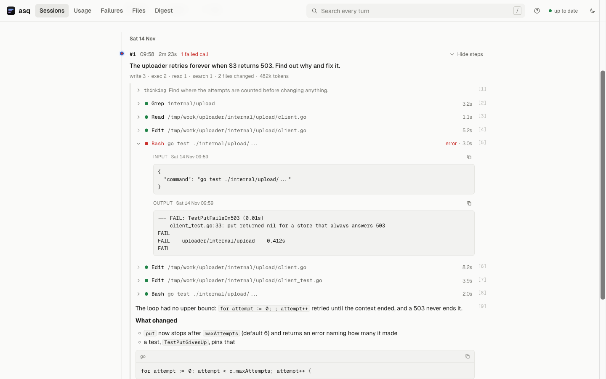

# asq

**把这台机器上所有 agent CLI 的会话历史，读成同一份记录：可搜索、可阅读、可交接、可度量。**

[English](README.md)

Claude Code、Codex、Gemini CLI、OpenCode、Grok、Antigravity、Pi、DeepSeek Harness、Hermes、OpenClaw、
GitHub Copilot CLI 各自都记录了自己做过的事——十一种格式，十一个位置。
`asq` 把它们读进同一个模型，回答你真正会问的问题：

- *上次这个问题我是怎么解决的？* —— 对所有会话的每一轮做全文搜索
- *那个 agent 当时在干什么？* —— 任意会话先看成一串「轮次」，再逐步展开
- *从它停下的地方接着干* —— 生成一份另一个 agent 可以直接接手的交接简报
- *token 都花在哪了？* —— 输入、输出、推理与缓存命中率，按模型 / 日期 / 项目 / 会话汇总
- *agent 干了多久、什么时候干的？* —— 按天、周、月统计 agent 工作时长，以及它落在一周里的哪些小时
- *什么总在失败？* —— 每一次失败的工具调用，带命令和输出末尾、同一命令后来是否通过，以及按命令看哪些还没解决

它是一个静态二进制，只读，除非你明确让它发，否则任何内容都不会离开这台机器。

```console
$ asq ls
claude/aaaa1111  28m ago · 2 turns · 1 failed · 1 agent · /work/alpha · main
  Fix flaky test
codex/bbbb2222   2d ago · 1 turn · /work/beta · release
  rotate the deploy key

$ asq search 数据库
1 turn in 1 session

1. claude/aaaa1111-0000-4000-8000-000000000001#2  2026-11-13 18:13 · /work/alpha  ✓
   ask    现在给数据库加索引
   answer 索引已加上，另外 orders 表也缺一个。

$ asq show claude/aaaa1111#1
claude/aaaa1111-0000-4000-8000-000000000001#1 · 2026-11-13 17:43 · 20s · exec 1 · failed 1 · 2.1k in · 70 out · cache 92%

17:43:39 ASK
    fix the flaky test
17:43:44 thinking the order of a map is not stable
17:43:44 Bash go test ./...  ✗ failed · 2s  [2]
    --- FAIL: TestOrder
    dial tcp: ECONNREFUSED 127.0.0.1:5432
    exit status 1

17:43:59 REPLY
    The test depended on map order; fixed by sorting the keys.
```

## 核心想法

不管是哪个 CLI，一次会话说的都是同一件事：**人提出要求，agent 干活，agent 给出回答。** 这一来一回就是这里的
基本单位——一「轮」（turn）——`asq` 提供的一切都是对轮次的某种呈现：

```
会话 ─┬─ 第 1 轮   提问 → 回复、思考、工具调用及其结果 → 最终回答
      ├─ 第 2 轮
      │    └─ 这一轮启动的子 agent：它自己是一个会话，挂在本会话之下
      └─ 第 n 轮
```

每个 CLI 一个适配器，只负责把它的 transcript 转成这份记录，别的什么都不做。列表、搜索、简报、用量、失败、
trace、网页都只写一遍，写在这份记录之上——所以对每个 CLI 行为一致，新增一个 CLI 只是一个小包。token 计数在读入时
就已归一（input 不含缓存部分，output 一定包含 reasoning），跨 CLI 求和才是同口径相加。→ [记录模型](docs/model.md)

## 安装

**macOS 与 Linux** —— 下载对应平台的发布包，用发布的校验和验证后装进 `~/.local/bin`
——用户自己的目录，全程不用 sudo（`asq` 读的就是这个用户的会话）。若该目录不在 PATH
里，脚本会给出要加的那一行；要装到全机器共享的位置，
`INSTALL_DIR=/usr/local/bin sh install.sh`，这一种才会用到 sudo：

```sh
curl -fsSL https://raw.githubusercontent.com/itswl/agent-session-query/main/install.sh | sh
```

**Windows**（PowerShell）：

```powershell
irm https://raw.githubusercontent.com/itswl/agent-session-query/main/install.ps1 | iex
```

**Homebrew**（macOS 与 Linux）和 **Scoop**（Windows），以本仓库作为 tap 和 bucket——之后
`brew upgrade` 与 `scoop update asq` 会跟上每次发布：

```sh
brew tap itswl/asq https://github.com/itswl/agent-session-query
brew install itswl/asq/asq
```

```powershell
scoop bucket add asq https://github.com/itswl/agent-session-query
scoop install asq/asq
```

**用 Go**（1.26 及以上；无 cgo，不需要其他工具链）：

```sh
go install github.com/itswl/agent-session-query/cmd/asq@latest
```

也可以从 [releases](https://github.com/itswl/agent-session-query/releases) 直接下载压缩包（三个系统均提供
amd64 与 arm64），或运行容器镜像 `ghcr.io/itswl/agent-session-query` —— 见 [部署](docs/deploy.md)。

然后：

```sh
asq doctor     # 找到了哪些存储，各自是否能读
asq ls         # 第一次运行会建索引：每 GB 历史大约一分钟
```

安装脚本核对的校验和与压缩包来自同一个 release：它能发现下载出错，发现不了整个 release 被替换。
能说明文件来历的是构建证明（build attestation）——每个压缩包、安装脚本和镜像都有一份，由发布
workflow 签名，写明构建它的那次运行和那个 commit：

```sh
gh attestation verify asq-darwin-arm64.tar.gz --repo itswl/agent-session-query
gh attestation verify oci://ghcr.io/itswl/agent-session-query:latest --repo itswl/agent-session-query
```

## 升级

再运行一次安装脚本即可。它会把新版本装到 PATH 上现有 `asq` 所在的位置、直接覆盖（那个目录需要
sudo 的话就用 sudo）：之后运行的就是新版本，macOS 对旧版本授予的权限也会保留。用 Go 装的，还是
同一条 `go install …@latest`；容器则重新拉取镜像再启动（见[部署](docs/deploy.md#upgrading)）。

常驻运行的 `asq serve` 在重启之前，跑的仍是旧版本。页面上会提示，`asq doctor` 也会说——它会
问本机上的 server 跑的是哪个 `asq`：

```sh
launchctl kickstart -k "gui/$(id -u)/io.github.itswl.asq"     # macOS，LaunchAgent
systemctl --user restart asq                                    # Linux，systemd 单元
```

Windows 上正在运行的 `asq.exe` 无法被替换：先 `schtasks /end /tn asq`，再运行安装脚本，然后
`schtasks /run /tn asq`。索引不需要任何处理：读取某个 CLI 文件的方式有变化的版本，会在第一次
查看存储时自己重新读一遍。

## 卸载

asq 写下的任何东西都不是你的历史（让 `asq keep` 存下的副本除外）——各 CLI 的存储归它们自己，asq 从不改动。要删的只有
这些，顺序随意（macOS 与 Linux）：

```sh
rm ~/.local/bin/asq                          # 装到了 /usr/local/bin 的话：sudo rm /usr/local/bin/asq
rm -rf ~/Library/Caches/asq ~/.cache/asq     # 索引，需要时会自动重建
rm -rf "$HOME/Library/Application Support/asq" ~/.local/state/asq   # 状态：登录签名密钥、已发给 collector 的清单、asq keep 存下的副本
```

用 Homebrew 或 Scoop 装的，二进制改用 `brew uninstall asq` 或 `scoop uninstall asq` 删除。

Windows：删除 `%LOCALAPPDATA%\Programs\asq`、`%LocalAppData%\asq` 和 `%AppData%\asq`，并把
用户 PATH 里的 `asq` 条目移除。若设过 `ASQ_INDEX` 或 `ASQ_STATE`，后两项在你说的地方，照那里
删。为 PATH 加过的 shell rc 那一行也可以一并删掉。

`asq keep` 存下的副本（如果让它存过）是 CLI 删掉的会话仅剩的一份。它们在状态目录里，或者在
`asq keep --dir` 指定的目录里；`asq keep` 会说是哪个。想留着就先挪走。

若 `asq serve` 是常驻运行的，先停掉服务再删二进制——`asq service uninstall` 或
`brew services stop asq`；手工配置的 launchd、systemd 或计划任务，按[部署](docs/deploy.md)里写的
停；容器则是 `docker rm` 加它的 `/data` 卷。

## 命令

| | |
|---|---|
| `asq ls` | 最近的会话，以及每个 agent 是在干活、在等某个调用，还是已经做完 —— `--state waiting,idle`、`--project`、`--since 7d`、`--source codex`、`--branch`，或标题里的一个词 |
| `asq search <词>` | 包含这些词的轮次：提问、回复、思考、工具输入与输出、会话标题 |
| `asq show <ref>` | 把会话看成轮次列表；`<ref>#4` 逐步展开某一轮；`--seq 12` 完整看某一步；`-f` 实时跟随 |
| `asq brief <ref>` | 整个会话的交接简报：问了什么、改了什么、什么失败了、结论是什么，以及现在怎样了 —— 只要其中一段时用 `--turn N`、`--from N`、`--since 2h` |
| `asq pack` | 把多个会话合成一份文档，由旧到新 —— `--project`、`--since` |
| `asq export <ref>` | 导出整个会话 —— `--format md \| json \| jsonl \| html` |
| `asq usage` | 模型调用消耗 —— `--by model \| day \| week \| month \| source \| project \| session` |
| `asq failures [词]` | 失败的工具调用 —— `--open` 只看同一命令后来没通过的、`--by command` 按命令归并、`--tool Bash`、`--since`，或命令与输出中包含的词 |
| `asq digest` | 一段时间的工作按项目汇总，并列出其中的会话 |
| `asq files <路径>` | 碰过某个文件的轮次 —— `--changed` 只看修改 |
| `asq why <文件>:<行>` | 最后改动这一行的 commit 出自哪个会话 —— 借 `git blame`，只读 |
| `asq projects` | 会话所在的工作目录 |
| `asq resume <ref>` | 在原 CLI 里重新打开该会话的命令 —— `--run` 直接执行 |
| `asq keep` | 为 CLI 会删除的会话留一份副本 —— `--all`，或用 `<ref>` 只留某一个会话 |
| `asq serve` | 网页与 HTTP API |
| `asq service install` | 让 `asq serve` 常驻——LaunchAgent、systemd unit 或计划任务，写入本二进制的完整路径；`status`、`uninstall` |
| `asq mcp` | stdio 上的 MCP server，让 agent 查询自己的历史 |
| `asq skill` | 告诉 agent 什么时候、怎样使用 asq 的 skill，存到它的 CLI 读取 skill 的地方 |
| `asq otel` | 把会话导出为 OpenTelemetry trace |
| `asq doctor` · `asq index` | 检查各存储、索引和本机运行的 server · 查看、重建或删除索引 |

**ref** 就是 `ls` 和 `search` 打印的东西：`claude/3f2a9c1e`，或者只写会话 id 的开头，像引用一个 commit
那样。`#4` 指第 4 轮。所有命令都支持 `--json`；`show`、`search`、`brief` 和 `pack` 支持
`--max-chars`，像 MCP 工具那样把文本回答限制在预算之内。

**搜索**支持 `"短语"`、`-排除词`，以及 `ask:` `reply:` `thinking:` `tool:` `output:` `title:` 把某个词限定在一轮的某个部分或会话标题。
裸词按前缀匹配（`rebind` 能找到 `rebinding`），英文词也匹配它的其他词形（`retries` 能找到 `retried`），完整的 commit id 能找到 `git commit` 打印过它开头几位的那一轮。中文、日文、韩文、泰文按子串匹配：`asq search 数据库` 可以直接用。
没有哪一轮包含全部的词时，结果会说明缺的是哪个词，并列出最接近的几轮，标为部分匹配；如果是筛选条件（`--since`、`--project`）把包含这些词的轮次挡在了外面，还会说明外面有多少轮，以及去掉哪个参数能看到。
→ [命令行](docs/cli.md)

## 网页

```sh
asq serve --open        # http://127.0.0.1:7717
```



同一份记录的浏览器形态：带筛选的列表、高亮命中的搜索、把会话展开成轮次时间线（可以一路点到某次工具调用的完整输出，以及其中粘贴或返回的图片）、
用量图表、失败列表、摘要——agent 干活时实时更新，并标出哪些 agent 正在干活、哪些在等某条命令或权限确认、哪些已经做完在等你。默认只监听回环地址；没有 token 时拒绝监听其他地址。
`asq service install` 让它常驻，登录即启动。
→ [网页](docs/ui.md) · [HTTP API](docs/api.md) · [部署](docs/deploy.md)

## 给 agent 用：MCP

能查询自己历史的 agent 不会把同一个问题解决两遍——而且它能读到*另一个* agent 做过的事：Claude Code 可以搜到你上周和
Codex 的那次会话。

```sh
claude mcp add --scope user asq -- asq mcp      # Claude Code
codex mcp add asq -- asq mcp                    # Codex
gemini mcp add --scope user asq asq mcp         # Gemini CLI
opencode mcp add asq --global -- asq mcp        # OpenCode
```

其他客户端：命令是 `asq mcp`，走 stdio。运行中的 `asq serve` 也在 `/mcp` 上以 HTTP 提供 MCP。

告诉 agent 什么时候、怎样使用 asq 的 skill（通过这些工具；没有 MCP 时通过命令行，比如 Pi）已经内置：
`asq skill` 把它打印出来，存到各个 CLI 读取 skill 的目录即可。

```sh
mkdir -p ~/.claude/skills/agent-sessions ~/.agents/skills/agent-sessions
asq skill > ~/.claude/skills/agent-sessions/SKILL.md    # Claude Code
asq skill > ~/.agents/skills/agent-sessions/SKILL.md    # Codex、Gemini CLI、OpenCode、Pi
```

Windows 上要在 cmd 里执行，写法见 [A skill](docs/mcp.md#a-skill)。

十个只读工具——`search`、`sessions`、`read`、`brief`、`pack`、`usage`、`failures`、`digest`、`files`、
`projects`——返回紧凑的纯文本而不是 JSON，按预算截断（调用方可以调大），并遮掉形似密钥的字符串：模型读到的每个字都
按 token 计费，而且会随它离开这台机器。两个 prompt 在 Claude Code、Gemini CLI 和 OpenCode 里成为斜杠命令。在 Claude Code 里，
`/asq:handoff` 把这个仓库里最新的另一个会话（不论哪个 CLI 的）整个写成简报放进对话，交给当前 agent 接手；
`/asq:catchup` 放进这里最近一周的会话。→ [MCP](docs/mcp.md)

## Trace

```sh
asq otel --endpoint https://collector.example:4318            # 只发时间、模型、token、工具名
LANGFUSE_PUBLIC_KEY=… LANGFUSE_SECRET_KEY=… asq otel --content asks --every 10m
```

每一轮是一条 trace：每次模型响应一个 span（带 token），它发起的工具调用挂在它下面，子 agent 挂在启动它的那次调用下面。
遵循 OpenTelemetry GenAI 约定，外加 Langfuse 需要的属性。span id 由内容推导，另有一本账记录每个 collector
已经收到什么，所以一轮只发一次。默认**不发送任何对话文本**——`--content asks` 或 `all` 才会带上。
→ [遥测](docs/telemetry.md)

## 读取哪些 CLI

| `--source` | CLI | 会话位置 |
|---|---|---|
| `claude` | Claude Code | `~/.claude/projects` —— 包含子 agent 与 workflow agent |
| `codex` | Codex | `~/.codex/sessions`，以及旁边的 `archived_sessions` |
| `gemini` | Gemini CLI | `~/.gemini/tmp` |
| `opencode` | OpenCode | `~/.local/share/opencode/opencode.db` |
| `grok` | Grok CLI | `~/.grok/sessions` |
| `antigravity` | Antigravity | `~/.gemini/antigravity-cli`、`~/.gemini/antigravity` |
| `pi` | Pi | `~/.pi/agent/sessions` |
| `dsh` | DeepSeek Harness | `~/.dsh/sessions` |
| `hermes` | Hermes | `~/.hermes/state.db` |
| `openclaw` | OpenClaw | `~/.openclaw/agents` |
| `copilot` | GitHub Copilot CLI | `~/.copilot/session-state` |

各 CLI 自己用来挪动存储位置的环境变量都会被遵守（`CLAUDE_CONFIG_DIR`、`CODEX_HOME` 等）。别处的存储——另一台机器的
home 目录、一份备份——按名字加进来：`asq ls --path claude@box2=/mnt/box2/.claude/projects`，其中的会话显示为
`claude@box2/…`。两个存储里都有的同一个会话只列一次、只算一次。→ [数据来源](docs/sources.md)

## 为什么快，为什么可以放心

- **查索引，不扫文件。** 第一次运行把所有 transcript 读进缓存目录里的一个 SQLite 文件（全文索引、压缩，只有原文件体积的
  一小部分）。此后每条命令只检查哪些 transcript 变了——每个文件一次 `stat`——只读变化的文件，且只重写其中变化的轮次；Claude Code 的会话只从最新一轮开始的地方读起。
  对几个 GB 的历史做搜索是毫秒级。索引只是缓存：`asq index rm` 之后会自动重建；损坏的索引会被移到一旁，不用你开口就
  重建。它只装着各存储里现有的会话，CLI 删掉的会话也会从索引里消失——而 Claude Code 和 Gemini CLI 会删除 30 天没有
  用过的会话，除非在它们的设置里改掉；它们占的空间会还给磁盘。`asq doctor` 会指出是哪个设置，并说明每个存储最早到哪
  一天。`asq keep --all` 会在 asq 自己的目录里为每个会话留一份副本，CLI 删掉之后就从副本读。
- **只读。** `asq` 里没有任何东西会写入某个 CLI 的存储。
- **本地。** 没有遥测，没有网络请求，没有账号。只有两样东西可能把内容发出去，而且都是你自己指定去向的：`asq otel`，
  以及你把 MCP server 交给的那个 agent。
- **展示时小心。** 工具输出里的终端转义序列在到达你的终端之前就被去掉。凡是给别人看的东西——简报、pack、MCP 回答、
  trace——都会遮掉形似密钥的字符串（API key、token、私钥：那些“自报家门”的形状；一段散文里的密码无法识别，文档里
  也如实说明）。
- **对外服务时有防护。** 没有 token：只监听回环地址，并拒绝 DNS rebinding、跨站请求，以及代理或隧道加了转发头
  （`X-Forwarded-*` 之类）的请求。不加这类头的代理或隧道，与本机自己的程序无从区分：不要把它们放在没有 token
  的服务前面。有 token：程序用 `Authorization` 头，网页用 `HttpOnly` cookie，猜错会被限速并记入日志。

## 文档

[记录模型](docs/model.md) · [命令行](docs/cli.md) · [网页](docs/ui.md) · [HTTP API](docs/api.md) ·
[MCP](docs/mcp.md) · [遥测](docs/telemetry.md) · [数据来源](docs/sources.md) · [部署](docs/deploy.md) ·
[开发](docs/development.md)

（文档正文为英文。）

## 许可证

[MIT](LICENSE)
