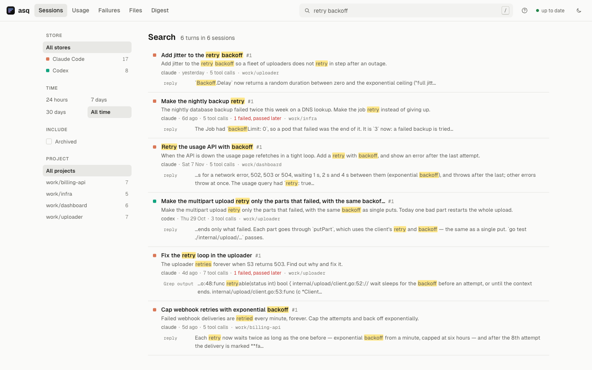
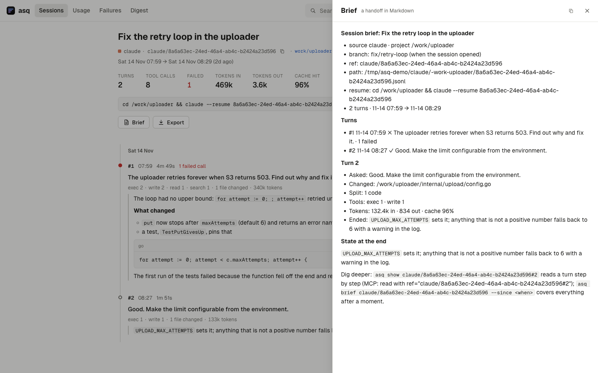
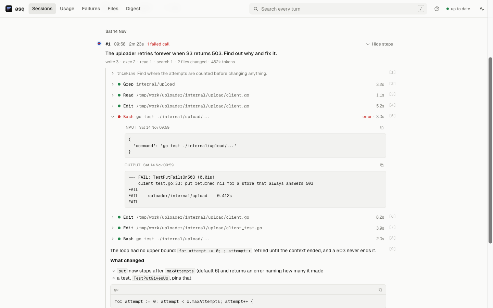
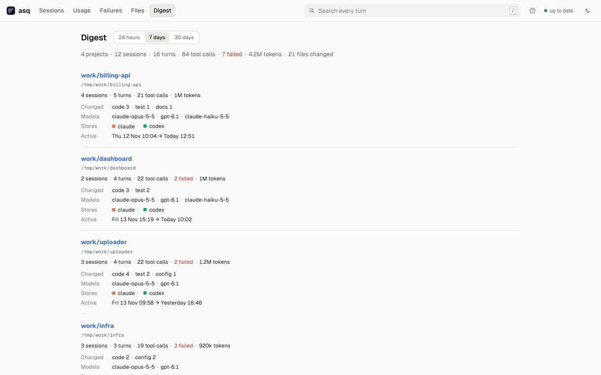

# The page

```sh
asq serve --open        # http://127.0.0.1:7717
```

The page is the same record as the command line, for reading at length: a list to find a session
in, a timeline to read it by, and three reports. It is a client of the [HTTP API](api.md) and
uses nothing else, so anything it shows can be had from the API too.


## Sessions

The list is grouped by day, newest first, fifty at a time. A row is the session's title, its last
ask and how it was answered, and the facts worth scanning for: which CLI, how many turns and tool
calls, how many of those failed, subagents, project, branch. A session written in the last two
minutes is marked *live*.

The filters on the left — store, time, project, archived sessions, subagent transcripts — live in
the address, so a filtered view can be bookmarked and Back goes where you expect. The counts
beside each store are what the list shows of it.

## Search

Type in the box (`/` focuses it). Results are **turns**, best match first, each with what was
asked there and the lines the words were found in — a reply, the reasoning, a tool's input or its
output — with the matches marked. The query syntax is the [command line's](cli.md#finding);
`?` shows it. A result opens its session at that turn, on the step that matched.



## A session

`/s/<store>/<id>` — the address is the session's ref, and `#4` on the end is turn 4, `#4.31`
step 31 in it. Any of these can be pasted to someone with the same history.

The head says what the session is: title, ref, project, branch, when, totals, and the command
that reopens it in its own CLI. **Brief** opens the [handoff brief](cli.md#handing-over) with a
copy button; **Export** downloads the session as Markdown, JSON, JSON Lines or a standalone
page. A subagent's transcript links to the session it ran in, and a session lists its subagents.




Below it, the turns: for each, the ask in full, a line of facts (what kinds of tool calls, files
changed, tokens), and the answer. Only this outline is loaded up front — a long session is
megabytes — and a turn's steps are fetched when it is opened.



Opened, a turn is its steps in order. A tool call is one row — the tool, what it was given, how
it ended, how long it took — that opens to its input and output. Long output arrives as its head
and tail; *Show all* fetches the rest. Reasoning and injected context are folded; a compaction or
an interruption is a labelled divider; rows a forked agent copied from its parent are grouped
and dimmed. A call that started a subagent links to it.

How a call ended is said by its mark and, when it is anything but fine, in words: *error*,
*interrupted*, *no result yet* — and **outcome not recorded** when the CLI wrote down no outcome
at all, which is not the same as success and is not shown as one.

While a session is being written the page follows it: new turns appear, open turns refresh, and
if you were reading at the end you stay at the end. Scroll up and it leaves you where you are;
the button at the bottom takes you back to the newest turn, or turns following off.

## Reports

**Usage** — tokens over rolling windows, the last thirty days as stacked bars (cache reads,
cache writes, input, output; *Without cache reads* rescales to what is left, since cache reads
are usually most of it), then tables by model, store and project — with how much of the output
was reasoning, where the provider said, and the share of the prompt that came from cache. Every
rounded figure carries its exact value on hover, and the chart can be read as a table. The
reports are in tokens: a session's own cost, where its CLI recorded one, is on the session's
page and [is not summed](cli.md#measuring).


**Failures** — the tool calls that failed in the last day, week or month, newest first: the
command, how it ended, the end of what it printed, and a link to the step. The chips narrow to
one tool.


**Digest** — the same window per project: sessions, turns, tool calls and failures, tokens, files
changed by kind, which models and CLIs did the work.



## Keys

| | |
|---|---|
| `/` | search |
| `j` `k` | next, previous — a row in a list, a turn in a session |
| `Enter` | open |
| `o` | show or hide a turn's steps |
| `e` | expand every step of the opened turns |
| `g g` · `G` | top · bottom |
| `Esc` | back to the list |
| `?` | search syntax and keys |

## Dark, small, signed in

The page follows the system's colour scheme, and the button in the bar overrides it. It is laid
out for a phone as well as a desk.

<p>


</p>

When the server was started with a token the page asks for it once and nothing else is shown
until it has it. The token is exchanged for a cookie that script cannot read, and is not kept by
the page. See [who may ask](deploy.md#who-may-ask).

If the index is still reading a large history, the bar says how far it is and what is on screen
covers what has been read. If a store could not be read, a notice says which and why: an empty
list is never the only sign that something broke.

Which `asq` is running is at the foot of the help (`?`), with a link to what that release
changed, and on the name in the bar. A page left open while the server was upgraded still runs
the page it was loaded with; it says so, and offers to reload.

## Quick, and quiet

**Going from one view to another is not a wait.** Each view keeps what it was last answered for
as long as the page is open. Opened again, it draws that at once and asks for the fresh answer
behind it; an answer that has not changed draws nothing, so what is under the pointer stays
there. If the fresh answer cannot be had, what is drawn stays, and a line above it says that it
could not be refreshed and why, with a way to try again: a failure does not take away what was
there, and what was there is not passed off as current. The next answer that comes takes the
line away.

A list is kept by its address. Back from a session returns to it whole and to where it was read,
and the rows that changed meanwhile are folded in where they stand. The link in the bar and a
filter taken off again show it at once from its top, and its first page then becomes what the
server says now: what was kept below it may no longer match — *Today* is yesterday after
midnight — or be gone. A search comes back whole on Back too, but is asked for afresh any other
way, since what it found is ranked rather than dated and cannot be brought up to date row by row.
Pointing at a view's link asks for it before the click lands. Nothing of this outlives the page,
and all of it is dropped when the sign-in is lost.

**The status says one of three things**: *up to date*; *reading 412 of 1,276…* while the index
catches up — a first read, or many transcripts after a while away; *reconnecting…* if the
connection has been gone for more than a moment. It does not report the reading that follows a
session as it is written. With an agent at work that never stops, and the list shows its result
anyway.

**A tab nobody is looking at asks for nothing.** Changes that arrive while the page is hidden
are remembered as one fact — something changed — and fetched when it is looked at again. After a
minute hidden it lets go of the stream as well, so the server stops following the stores closely
for the sake of a tab in the background. A tab opened in the background counts that minute from
when it loaded, and one whose stream was being reconnected when the minute ran out does not open
it again until it is looked at.

## How it is built

By hand, and that is a decision rather than an economy.

- **No build step, no dependencies.** HTML, CSS and ES modules, embedded in the binary as they
  are: `web/` is what the browser gets. There is nothing to install, audit or keep up to date,
  and `asq serve --page-dir web` serves the directory live for working on it.
- **Transcript text never becomes markup.** A transcript is other people's text — model output,
  tool output, whatever a web page said to an agent. Every string from the API reaches the page
  as a text node or an attribute value, through one element-building function that refuses the
  alternatives. The Markdown rendering of replies is a small subset (code, emphasis, lists,
  links to `http` and `https` only) built as nodes, not parsed into HTML.
- **A policy that enforces it.** The page is served with a Content-Security-Policy that allows
  scripts and styles from its own files only — no inline script, no inline style, no other
  origin, no framing. If the rule above were ever broken, the injected text still could not run.
- **Replies that are not pages.** What the API sends is JSON with no `<`, `>` or `&` in it —
  they travel as `\u003c`-style escapes — so a reply opened where a page was expected is text.
- **Named for what they are.** The page asks for its script, its style and its fonts under
  `/a/<tag>/`, where the tag is a hash of all its files; under that path they are kept for good.
  A new version is new paths, so a browser — or a cache in between that keeps scripts whatever
  the server says, as Cloudflare does for four hours by default — never runs a page the server
  no longer is. By their own paths the files are still served, and asked for again each time.
- **Tested for what a bundler would have caught.** `web/web_test.go` checks that every module a
  module imports exists, that everything the page points at is embedded, that no script uses a
  sink that turns text into markup, and that the HTML needs nothing inline.

The stream that keeps it live carries no content — only which sessions changed — and the page
asks for what it is showing. So a missed event costs a stale row until the next one, never a
wrong one.
