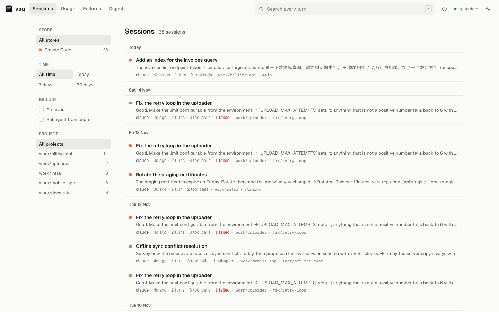
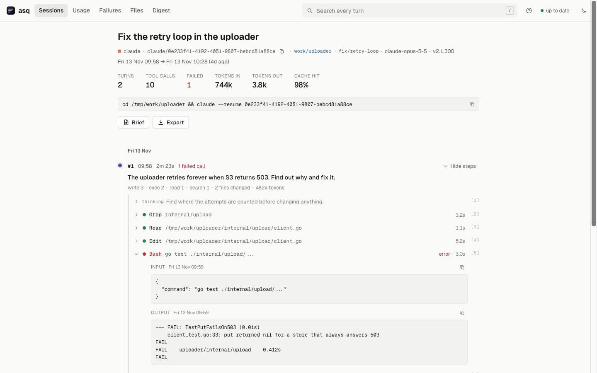
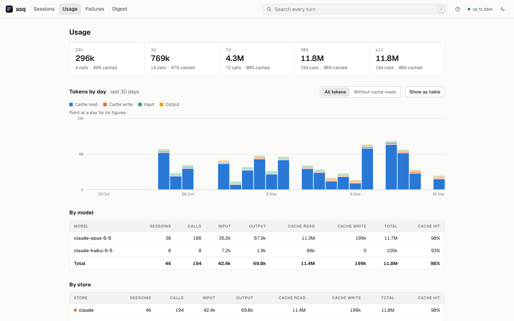
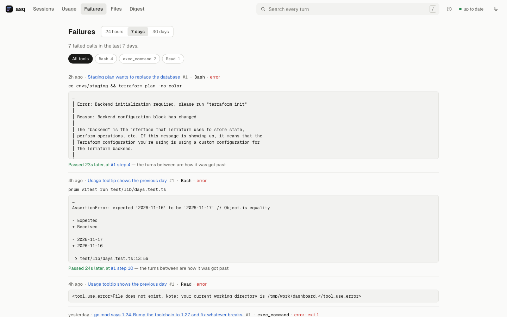
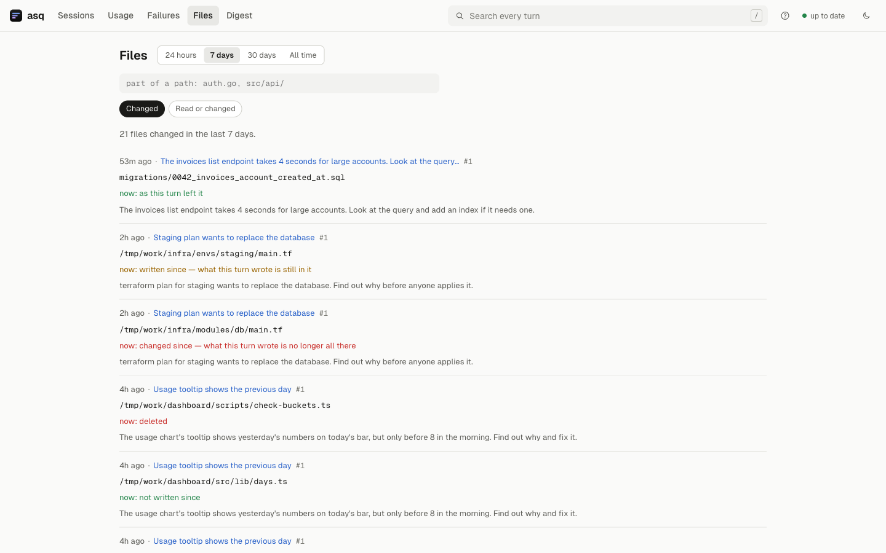
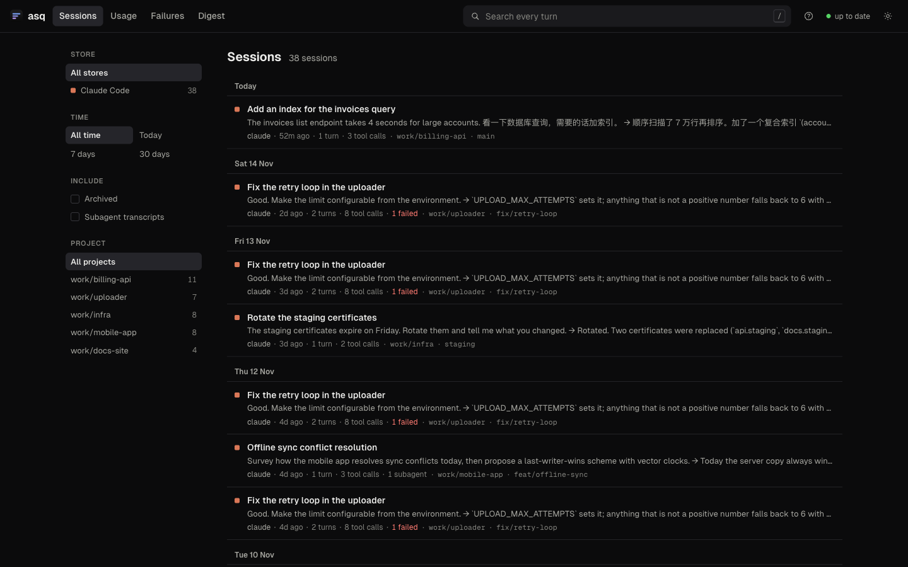
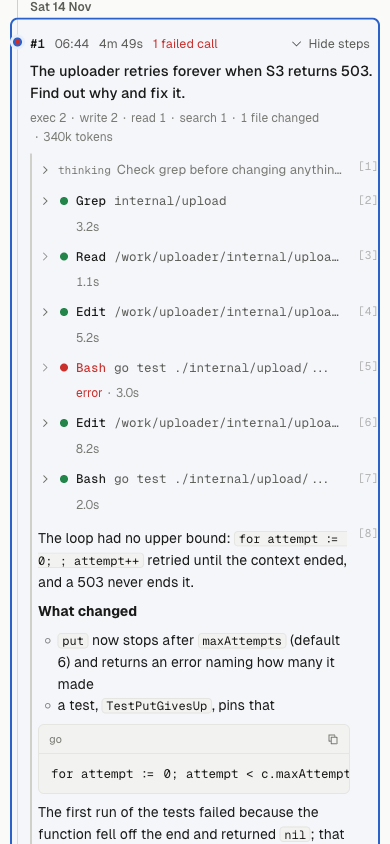

# The page

```sh
asq serve --open        # http://127.0.0.1:7717
```

The page is the same record as the command line, for reading at length: a list to find a session
in, a timeline to read it by, and three reports. It is a client of the [HTTP API](api.md) and
uses nothing else, so anything it shows can be had from the API too.



## Sessions

The list is grouped by day, newest first, fifty at a time. A row is the session's title, its last
ask and how it was answered, and the facts worth scanning for: which CLI, how many turns and tool
calls, how many of those failed and how many of those the same command passed later — in red
while one has not, muted once each has — subagents, project, branch. A session its CLI did not
name is titled by how its first ask begins, and while that is its last ask too, the line beneath
the title is the answer alone, which a phone has room for.

A row opens with where its agent stands, as its transcript says
([which CLIs say it](sources.md#where-a-turn-stands)): *working*; *waiting on Bash: npm run
build* — a command still running, or a prompt asking permission to run it, which a transcript
does not tell apart; or *your turn*, the agent done and waiting for you. Pointing at it says
since when. Working is said for ten minutes after the transcript was last written — an agent at
work writes as it goes — and the other two for a day. A session none of this is said of is
marked *live* when it was written to in the last two minutes. *Agents* at the top of the filters
narrows the list to *Working*, or to *Needs you*: the sessions waiting on a call, and those
where it is your turn.

What changed since you last looked is marked too: a session begun since is *new*, one begun
before and written to since is *updated*, and a line — *Changed since your last visit · Today
14:05* — runs above the first row that is older. The time is when you last looked at the list
before this visit. A visit lasts while the page is looked at: a reload, Back from a session or a
few minutes in another tab do not end it, so the marks stay while they are worked through. Five
minutes away — the page hidden or closed, the machine asleep — does, and the next visit is marked
from when you left. *Mark as seen* on the line clears the marks at once. A first visit marks
nothing.

The filters on the left — agents, store, time, project, archived sessions, subagent transcripts —
live in the address, so a filtered view can be bookmarked and Back goes where you expect. The
counts beside each store are what the list shows of it. A row's branch is a filter too: a tap on it
narrows the list to the sessions on that branch (a branch whose name contains it, as on the
command line), the filters name it, and *All branches* takes it off. A project chosen here stays
chosen in the reports — see [one project throughout](#one-project-throughout). A filtered list
is marked from the same time, and looking at it counts as looking at the list: if it did not,
someone who always reads one project would find everything in it marked.

## Search

Type in the box (`/` focuses it). Results are **turns**, best match first, each under its
session's title with what was asked there and the lines the words were found in — a reply, the
reasoning, a tool's input or its output — with the matches marked, the other forms of a word
found (*retried* for retries) among them, and how many of its calls failed and how many of those
passed later. The query syntax is the [command line's](cli.md#finding); `?` shows it. A search
keeps the list's filters, and from a report the project it is narrowed to. When no turn holds
every word, a note above the results says so and names any word no turn holds, and the results
are the turns that come closest, each saying which words it lacks. When the filters kept the
search from matching, it says how many turns outside them match, with a link that clears them —
or, for a match only archived sessions hold, includes those; when none do, it names the words
turns outside them hold. A result opens its session at
that turn, on the step that matched. Nothing in the
results is marked as new: they are ranked, not dated, so there is no line where the older ones
begin. A search is not a look at the list either, and does not move the time the list is marked
from.


## A session

`/s/<store>/<id>` — the address is the session's ref, and `#4` on the end is turn 4, `#4.31`
step 31 in it. Any of these can be pasted to someone with the same history.

The head says what the session is: title, ref, project, branch, where its agent stands — a
session waiting on a call links to that step — when, totals, and the command that reopens it
in its own CLI; for a session read from a store added by name, that is the command for the
machine it came from, labelled so. **Brief** opens the [handoff brief](cli.md#handing-over) with a
copy button, of the latest turn — or, chosen above it, of the turn in view and every turn after
it (*From #7*), or of the whole session; **Export** downloads the session as Markdown, JSON,
JSON Lines or a standalone page. **Keep** keeps a copy of the session and its subagents in asq's
own folder, so that it stays when its CLI deletes it ([`asq keep`](cli.md#maintaining)); pressed
again, it stops. It is offered for the CLIs that delete their own sessions, says *Kept* while
every session of the CLI is kept, and a session read from the copy says *kept copy*. A subagent's
transcript links to the session it ran in, and a session lists its subagents.




Below it, the turns: for each, the ask in full, a line of facts (what kinds of tool calls, files
changed, tokens), and the answer. *3 files changed* opens the list of them, named from the
session's directory, each a link to [Files](#reports) at that path, for how it stands now. A turn
with failed calls says how many, in red, unless the same command passed later for each of them —
in that turn or the three after it, [as failures judges it](api.md#reports) — when it says so,
muted: those were steps of the work, not where it stands. The head counts what *Passed later*
beside what *Failed*. Only this outline is loaded up front — a long session is megabytes — and a
turn's steps are fetched when it is opened.


Opened, a turn is its steps in order. A tool call is one row — the tool, what it was given, how
it ended, how long it took — that opens to its input and output. Long output arrives as its head
and tail; *Show all* fetches the rest. Reasoning and injected context are folded; a compaction or
an interruption is a labelled divider; rows a forked agent copied from its parent are grouped
and dimmed. A call that started a subagent links to it.

A picture pasted into the ask, or returned by a tool — a screenshot — is shown beneath it once
the turn is opened, read from the transcript then, and opens whole in a tab of its own; the row
of a call that returned one says *1 picture*. The page shows PNG, JPEG, GIF and WebP the
transcript holds, up to 8 MB. Any other file — a PDF, an SVG, a picture the transcript only
names — is its mark in the text alone: `[image · svg · 2 KB]`.

How a call ended is said by its mark and, when it is anything but fine, in words: *error*,
*interrupted*, *no result yet* — and **outcome not recorded** when the CLI wrote down no outcome
at all, which is not the same as success and is not shown as one.

While a session is being written the page follows it: new turns appear, open turns refresh, and
if you were reading at the end you stay at the end. Scroll up and it leaves you where you are;
the button at the bottom takes you back to the newest turn, or turns following off.

**Find** looks in this session alone, in every turn — the browser's own find sees only the steps
of the turns that are open. It takes the [search's syntax](cli.md#finding) and lists the turns
that hold the words in the order of the session, each with the lines they were found in; one
opens its turn at that step. When no turn of the session holds them all, it lists those that
come closest, and says what each lacks. Enter or the arrows beside the box step through them, the first
step from the turn in view, and Shift+Enter steps back. A session's subagents are sessions of
their own, and are found on their own pages. It is `f`, or *Find* in the session's head, after *Brief* and *Export*.

**On a phone** — or installed as an app, where there is no Back button and no address bar —
the head is the title and the first line of facts, and *Details* opens the rest: when, the
totals, the command that reopens it, the subagents. A row stays at the top while the session is
read: back to the list or report it was opened from (or to the sessions list), the turn in
view — type another number to go to that turn — the next failed turn (one with a failure the
same command did not pass later), find, the top, and the newest turn.

## Reports

Every view that reads a window of time offers the same ones, in the same words: **24 hours, 7
days, 30 days, All time**. They roll — the last 24 hours, not today — so a window reads the same
whenever it is asked. The sessions list and the usage tables show all time unless a window is
chosen; failures, files and the digest, the last 7 days.

**Usage** — tokens in each of those windows, and how long agents worked in it, with the one chosen
marked; the last thirty days as stacked bars (cache reads, cache writes, new input, output;
*Without cache reads* rescales to what is left, since cache reads are usually most of it),
whichever window is chosen; then tables by model, store, project and session over the chosen
window, which each names — with how much of the output was reasoning, where the provider said, and
the share of the prompt that came from cache; a session is its title, opening it, with its
subagents' tokens in it. Every table but the models' ends with *Agent time*, how long agents worked
on its turns. *New input* is the part of the prompt neither read from cache nor written to it: with
the two cache columns it is the whole prompt, which the command line and a session's page call
*in*. Every rounded figure carries its exact value on hover, and the chart can be read as a table.
The reports are in tokens and time: a session's own cost, where its CLI recorded one, is on the
session's page and [is not summed](cli.md#measuring).



**Failures** — the tool calls that failed in the window, newest first: the
command, how it ended, the end of what it printed, a link to the step, and where the same command
passed later. *Still open* keeps the ones whose command did not; *By command* shows one entry per
command that failed — how often, how many still open, in how many sessions, and the latest — the
ones still open first. The chips below narrow to one tool. A failure since you last looked at Failures is marked *new*, by the same visits as
[the sessions list](#sessions); the count above says how many, beside its *Mark as seen*. A
window with none says how many came before it, with a link to all time.



**Files** — the turns that changed a file in the window, newest first, each with
the ask that led to it and how the file stands now against what that turn left: *as this turn
left it*, *written since*, *changed since*, *not written since*, *deleted* — judged on this
machine, from the file itself ([how](api.md#reports)). A file whose folder cannot be read in time
— on a Mac, macOS asking on its screen whether `asq` may read Documents or Desktop — is listed
without it, and the page names the folder ([on macOS](deploy.md#keeping-it-running)). The box
narrows to paths that contain what is typed; *Read or changed* adds the turns that only read them.



**Digest** — the same window per project: sessions, turns, tool calls and failures — how many of
them passed later too — how long agents worked, tokens, files changed by kind, which models and
CLIs did the work; then the project's latest sessions, each opening it, with how its turns in
the window ended and the last thing its agent said, and a link to the rest. Above the projects,
*When agents worked* is the week by hour, on the clock of the machine `asq` runs on, each hour
as dark as the time agents worked in it, and each day's time at the end of its row.


### One project throughout

Every report can be narrowed to one project, and a project chosen once stays chosen: in the
sessions list's filters or a report's *Project* menu, it then goes with you between Sessions,
Usage, Failures, Files and Digest. It is in each view's address, so a narrowed report can be
bookmarked and Back undoes the choice; the links in the bar carry it on, through a session read
on the way. Esc from a session opened in a report goes back to that report as it was, its project
and its window, and a session opened from neither a list nor a report goes back to the sessions
of the project. Each report shows it beside its window, highlighted, says it in what it found —
*3 failed calls in work/api in the last 7 days* — and has × beside it for all projects again.

A project named in a report — a row of Usage's table, a heading of the Digest — opens its
sessions in the window the report is of, since that is what its figures count.

The window and the store do not travel. Each view keeps its own window, because they differ by
design: the list and Usage read all time unless told otherwise, Failures, Files and the Digest
the last week, and a window carried from one to the next would undo that on every move. The
store stays a filter of the list: the reports are of a project's work, and Usage and the Digest
say for themselves which stores did it — narrowed to one, they would have nothing to compare.

## Keys

| | |
|---|---|
| `/` | search |
| `j` `k` | next, previous — a row in a list, a turn in a session |
| `Enter` | open |
| `o` | show or hide a turn's steps |
| `e` | expand every step of the opened turns |
| `g g` · `G` | top · bottom |
| `12 G` | turn 12 of a session |
| `x` `X` | next, previous failed turn — after the one in view, and round from the end; a turn whose failures all passed later is passed over |
| `f` | find in this session |
| `Esc` | back to the list or report a session was opened from — or, with the find open, closes it |
| `?` | search syntax and keys |

## Dark, small, signed in

The page follows the system's colour scheme, and the button in the bar overrides it. It is laid
out for a phone as well as a desk.

<p>


</p>

When the server was started with a token the page asks for it once and nothing else is shown
until it has it. The token is exchanged for a cookie that script cannot read, and is not kept by
the page. See [who may ask](deploy.md#who-may-ask).

If the index is still reading a large history, the bar says how far it is and what is on screen
covers what has been read. If a store could not be read, a notice says which and why: an empty
list is never the only sign that something broke. If no store held a session at all, the list
says where the server looked — each store's place, and whether it is there and could be read —
and that `asq doctor` on that machine says more.

Which `asq` is running is at the foot of the help (`?`), with a link to what that release
changed, and on the name in the bar. A page left open while the server was upgraded still runs
the page it was loaded with; it says so, and offers to reload. A server whose binary an upgrade
replaced goes on with the old one until it is restarted; the page says that too.

Opened when the server cannot be reached — the machine asleep, the tunnel to it down — the page,
or the app installed from it, says so on a page of its own, with *Retry*, where it would show the
browser's error or the tunnel's. A service worker keeps that page and what it is drawn with, and
nothing else: no answer of the API, nothing of the record, so there is nothing to show until the
server answers again. Each version of the page brings its own, and lets the last one go. A
browser allows a service worker only over HTTPS or on this machine; a page served over plain HTTP
to another one has none, and shows the browser's error.

## Quick, and quiet

**Going from one view to another is not a wait.** Each view keeps what it was last answered for
as long as the page is open. Opened again, it draws that at once and asks for the fresh answer
behind it; an answer that has not changed draws nothing, so what is under the pointer stays
there. If the fresh answer cannot be had, what is drawn stays, and a line above it says that it
could not be refreshed and why, with a way to try again: a failure does not take away what was
there, and what was there is not passed off as current. The next answer that comes takes the
line away.

A list is kept by its address. Back from a session returns to it whole and to where it was read,
and the rows that changed meanwhile are folded in where they stand. The link in the bar and a
filter taken off again show it at once from its top, and its first page then becomes what the
server says now: what was kept below it may no longer match — the last 24 hours have moved on —
or be gone. A search comes back whole on Back too, but is asked for afresh any other
way, since what it found is ranked rather than dated and cannot be brought up to date row by row.
Pointing at a view's link asks for it before the click lands. A picture drawn is drawn again from
what the page has, so a turn refreshed as it is written does not fetch its pictures again. Nothing
of this outlives the page, and all of it is dropped when the sign-in is lost. What the browser
keeps longer is the theme; for the marks of what changed since you last looked, times; for the
tab's life, which notices were dismissed in it, as a hash of what they said: no answer, no text,
no id; and the service worker's page for when the server cannot be reached
([above](#dark-small-signed-in)).

**The status says one of three things**: *up to date*; *reading 412 of 1,276…* while the index
catches up — a first read, or many transcripts after a while away; *reconnecting…* if the
connection has been gone for more than a moment. It does not report the reading that follows a
session as it is written. With an agent at work that never stops, and the list shows its result
anyway.

**A tab nobody is looking at asks for nothing.** Changes that arrive while the page is hidden
are remembered as one fact — something changed — and fetched when it is looked at again. After a
minute hidden it lets go of the stream as well, so the server stops following the stores closely
for the sake of a tab in the background. A tab opened in the background counts that minute from
when it loaded, and one whose stream was being reconnected when the minute ran out does not open
it again until it is looked at.

## How it is built

By hand, and that is a decision rather than an economy.

- **No build step, no dependencies.** HTML, CSS and ES modules, embedded in the binary as they
  are: `web/` is what the browser gets. There is nothing to install, audit or keep up to date,
  and `asq serve --page-dir web` serves the directory live for working on it.
- **Transcript text never becomes markup.** A transcript is other people's text — model output,
  tool output, whatever a web page said to an agent. Every string from the API reaches the page
  as a text node or an attribute value, through one element-building function that refuses the
  alternatives. The Markdown rendering of replies is a small subset (code, emphasis, lists,
  links to `http` and `https` only) built as nodes, not parsed into HTML.
- **A policy that enforces it.** The page is served with a Content-Security-Policy that allows
  scripts and styles from its own files only — no inline script, no inline style, no other
  origin, no framing. If the rule above were ever broken, the injected text still could not run.
  Pictures come from its own origin too: a transcript's are sent by the API, as the picture
  their bytes are and nothing else.
- **Replies that are not pages.** What the API sends is JSON with no `<`, `>` or `&` in it —
  they travel as `\u003c`-style escapes — so a reply opened where a page was expected is text.
- **Named for what they are.** The page asks for its script, its style and its fonts under
  `/a/<tag>/`, where the tag is a hash of all its files; under that path they are kept for good.
  A new version is new paths, so a browser — or a cache in between that keeps scripts whatever
  the server says, as Cloudflare does for four hours by default — never runs a page the server
  no longer is. By their own paths the files are still served, and asked for again each time.
- **Tested for what a bundler would have caught.** `web/web_test.go` checks that every module a
  module imports exists, that everything the page points at is embedded, that no script uses a
  sink that turns text into markup, and that the HTML needs nothing inline.

The stream that keeps it live carries no content — only which sessions changed — and the page
asks for what it is showing. So a missed event costs a stale row until the next one, never a
wrong one.
